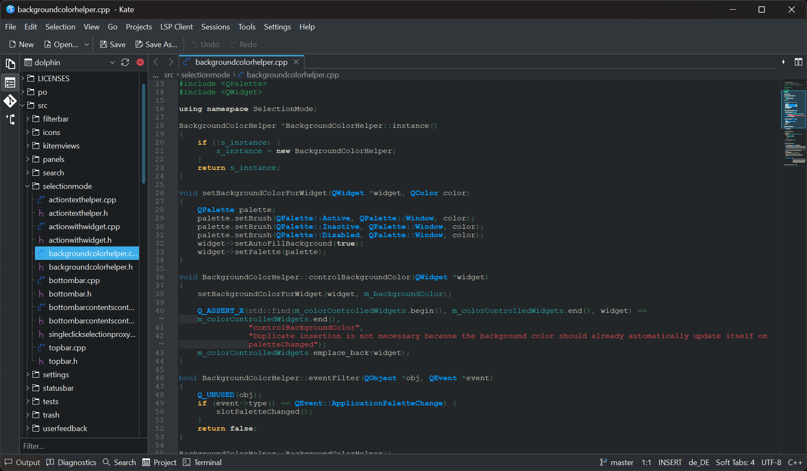
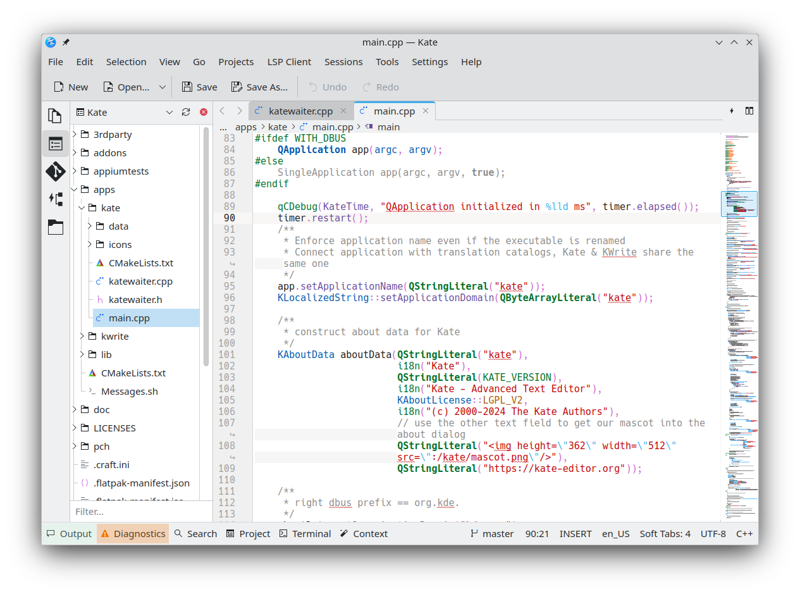

# Kate Advanced Text Editing for Code Projects

[](https://github.com/kate-text-editor/kate-editor/releases/)

Kate combines multi-document editing with split views, project tools and language-aware extensions.
Use the kate editor to keep source files, configuration and related notes in one working session.

The kate kde editor is developed by the KDE community.
This guide focuses on editing workflows, build prerequisites and the distinction between stable releases and nightly packages.

## Editing Across Files

A project often needs more than one document visible at the same time.
Kate supports horizontal and vertical splits so related files can stay in view.

- Compare an implementation with its declaration.
- Keep a configuration file beside the code that reads it.
- Use multiple selections for repeated edits.
- Fold sections when surrounding detail is distracting.
- Search a folder when a symbol or phrase spans several files.

Choose the view arrangement for the task in front of you.
A split is useful when it reduces navigation, but a crowded layout can hide the code you need to read.



## Matching Tools to the Task

| Task | Kate capability | What to check |
| --- | --- | --- |
| Edit related files | Tabs and split views | The active view contains the intended document |
| Review repeated text | Search and replacement | The match scope fits the change |
| Navigate a codebase | Project support | The folder represents the project you intend to inspect |
| Request language intelligence | LSP integration | The relevant language server is available |
| Format a document | External formatter integration | Formatting rules match the repository |
| Revisit a working set | Sessions | The session name identifies the task clearly |

The kate code editor can use external tools without replacing their configuration.
Language servers, formatters and build commands should match the project you are editing.

## Command-Line Editing

Kate accepts filenames and options from a terminal.
These independent examples show how to inspect available options, select a source location and open a named session.

```bash
kate --help
kate --line 42 --column 5 module.cpp
kate --start "Review" module.cpp notes.txt
```

Replace the example filenames with your own paths.
A named session can reuse an existing Kate instance associated with that session.

Use a descriptive session name for work you expect to resume.
Keep unrelated projects in separate sessions when their document sets would otherwise become confusing.

## Document-Level Preferences

Kate supports document variables for local editing preferences.
A modeline can record settings inside a source comment when that fits the repository's conventions.

This Python example requests spaces with a four-column indentation width.

```python
# kate: indent-width 4; space-indent on;
def render_label(name):
    return f"Item: {name}"
```

The first line is an editor directive inside a Python comment.
It does not change the Python program's runtime behavior.

The kate text editor also provides interactive preference controls.
Prefer shared project conventions when several contributors use different editors.

## Prerequisites

Building Kate requires a development environment for Qt and KDE Frameworks.
The libraries used by an installed application are not a substitute for development headers and build metadata.

- Use a C++20-capable compiler.
- Provide CMake 3.16 or newer for the base project.
- Provide Qt 6 development packages matching the source requirements.
- Provide KDE Frameworks 6 and Extra CMake Modules.
- Provide a build backend such as Ninja.
- Add optional component dependencies when enabling the corresponding features.

The root [CMakeLists.txt](CMakeLists.txt) declares the project's build configuration.
The development [CMakePresets.json](CMakePresets.json) contains additional configuration choices.

Check the selected revision before choosing exact dependency versions.
Development presets may require newer tooling than the base CMake project minimum.

## Building a Complete Checkout

Run these commands from a complete Kate source checkout with its dependencies available.
The example keeps generated build files in a separate directory.

```bash
cmake -S . -B build -G Ninja -DCMAKE_BUILD_TYPE=Debug
cmake --build build
ctest --test-dir build --output-on-failure
```

The final command runs the tests registered in that build tree.
Some tests depend on a suitable graphical environment and the enabled components.

> [!NOTE]
> The selected local files are a partial source collection.
> A complete checkout is required before these build commands can succeed.

Precompiled-header configuration is defined in [CMakeLists.txt](pch/CMakeLists.txt).
The shared header is [pch.h](pch/pch.h), while [kate_test_pch.h](pch/kate_test_pch.h) supports test compilation.

## Release Authenticity

KDE publishes checksums and detached signatures for its release source archives.
For KDE Gear 26.08.3, the source information page identifies Heiko Becker as the signing-key owner.

The published signing-key fingerprint is:

D81C0CB38EB725EF6691C385BB463350D6EF31EF

With the matching public key already obtained and independently verified, inspect it and check a downloaded source archive.

```bash
gpg --fingerprint D81C0CB38EB725EF6691C385BB463350D6EF31EF
gpg --verify kate-26.08.3.tar.xz.sig kate-26.08.3.tar.xz
sha256sum kate-26.08.3.tar.xz
```

Compare the calculated checksum with the value published for that exact archive.
A valid signature is meaningful only when you have established that the public key belongs to the expected signer.

These commands describe source-archive verification.
Windows packages and application-store deliveries use their own distribution and trust mechanisms.

## Windows Packages

The official download page lists Kate in the Microsoft Store.
It also offers a nightly 64-bit Windows installer for testing development builds.

Choose a stable distribution channel when you need a predictable editor for regular work.
Use a nightly package when you specifically want to evaluate current development.

- Check whether the package is stable or nightly.
- Match the architecture to the target computer.
- Record the installed version when reporting an issue.
- Review package-specific update behavior.

Treat portable behavior as a property of a particular package.
An extracted application folder does not by itself establish where preferences and session data are stored.



## Linux Packaging and Development Helpers

Linux distribution packages and application stores can provide different versions of Kate.
Compare the installed application version with the version required to reproduce a reported problem.

The selected [snapcraft.yaml](snapcraft.yaml) describes Kate's Snap packaging.
The helper [build_flatpak.sh](build_flatpak.sh) supports a developer workflow that builds and runs Kate in a Flatpak environment.

The helper expects supporting files from the complete source tree.
Read its prerequisites before treating it as a standalone build script.

## Language Services and Project Boundaries

Kate can combine syntax highlighting with language-server features.
A highlighted file and a fully configured language server provide different levels of assistance.

For a language-server issue, check the server executable and the project's configuration.
For a build issue, inspect the build command and its working directory.

Use the editor's project view to understand the files involved in a change.
Keep the project's existing build system as the authority for compilation and dependencies.

## Maintaining a Working Session

The kate open source text editor supports workflows that range from a single note to a collection of source files.
Keep the workspace small enough that its purpose remains clear.

Before a broad replacement, review the search results and confirm the file scope.
After changing indentation or encoding, inspect the affected diff before committing the result.

Save a named session when its collection of documents will be useful again.
Close stale views when they no longer support the current task.

## Related Search Terms

kate editor, kate kde editor, kate code editor, kate text editor, kate open source text editor, text-editor, editor, code-editor, ide, cross-platform, kde, qt, cpp
